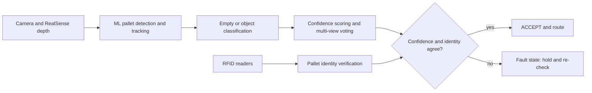

<h1 align="center">Tirth Patel</h1>

<h3 align="center"><i>Embedded Software &amp; Firmware Engineer</i></h3>

  Production C firmware on microcontrollers &nbsp;•&nbsp; Real-time sensing and control &nbsp;•&nbsp; Vision-guided automation

  
  
  
  

  
  
  

📍 Pomona, California &nbsp;|&nbsp; 🎓 MS Electrical &amp; Electronics Engineering, Cal Poly Pomona (Dec 2026) &nbsp;|&nbsp; 🟢 Open to full-time firmware and embedded software roles

---

## 👋 About me

It is easy to build a prototype. It is much harder to make it **survive real hardware, real noise, and real failure modes**. That gap is where I work.

I am an embedded software engineer who has shipped **production C firmware** on Nuvoton microcontrollers (I2C drivers, ADC sensor acquisition, timer interrupts, and relay control with fault detection, held to **±1°C calibration accuracy**) and who debugs at the bench with oscilloscopes and root-cause analysis, which improved reliability and performance by **20%**.

Right now I am finishing my MS at Cal Poly Pomona while building a **vision-guided Industry 4.0 conveyor cell**, where a machine learning vision model, RFID, and a confidence-driven decision engine have to agree before anything acts. At 19, I founded a driver-license-controlled smart vehicle project and secured **₹73,000 in Gujarat SSIP funding**.

> *"Innovation lives at the intersection of firmware."*

---

## 📊 At a glance

| | |
|:--|:--|
| ⚙️ **Production firmware** | C on Nuvoton, bare metal, I2C, ADC, timers, GPIO |
| 🎯 **Calibration accuracy** | ±1°C held in a production product |
| 📈 **Reliability and performance** | +20% through bench debugging and root-cause analysis |
| 🏁 **Funded hardware startup** | ₹73,000 SSIP funding, founded at 19 |
| 🤖 **Current research** | Vision, RFID, and PLC-linked conveyor automation (CREST-RASM) |

---

## 🛠️ Tech stack

**Languages**
&nbsp;

**Microcontrollers and boards**
&nbsp;

**Interfaces and peripherals**
&nbsp;`I2C` `SPI` `UART` `ADC` `GPIO` `PWM` `Timers and Interrupts` `EEPROM` `CAN`

**Platforms and tools**
&nbsp;`Embedded Linux` `ROS2` `Keil uVision` `Git` `Oscilloscope` `Intel RealSense` `LiDAR` `IMU`

**Engineering practices**
&nbsp;`Bare-metal firmware` `Finite state machines` `Real-time design` `Root-cause analysis` `Test plans and automation` `Code reviews` `Technical documentation`

---

## 🚀 Featured projects

### 🏭 Vision-Guided Industrial Sorting, Digital Twin &nbsp;·&nbsp; *CREST-RASM, 2026 to present*
    

A conveyor cell where **vision, RFID, and sensor feedback must all agree** before the system trusts a reading. The hard part was never detecting the object. It was deciding whether to trust that detection.

- Modelled the cell as a **finite state machine** in Python and C++ with explicit fault states, so nothing acts on a stale or low-confidence reading.
- Built a **confidence-driven decision engine** combining a machine learning vision model with Intel RealSense depth localization.
- Designed a **hash-map RFID identification** system with constant-time pallet lookup, re-verifying tag and vision every cycle to catch object swaps and pallet reordering.
- Fixed two real failures, **object swapping** and **pallet reordering**, with a continuous confidence-monitoring buffer and an RFID re-verification check before every action.
- Linked sensor conditions to the conveyor through the **PLC** so actions only happen when every condition agrees.

---

### 🔐 Driving License Controlled Smart Vehicle (SafeDrive) &nbsp;·&nbsp; *Founder, 2022 to 2024*
    

An ignition system that **starts the vehicle only when the license and fingerprint checks agree**, built to stop underage and unauthorized driving.

- Read the RFID license over **SPI** and the fingerprint sensor over **UART** on a Raspberry Pi running Linux.
- Wrote the Python logic that decides allow or block from both results and rejects incomplete identity checks.
- Added LED status feedback so the driver sees why ignition is blocked.
- A central device for authorized officials issues licenses and stores driver records in a database.
- Took the prototype from concept to a funded product with **₹73,000 SSIP funding**.

---

### 🌡️ Autoclave / Heater Controller &nbsp;·&nbsp; *Nuvoton Mini51, bare-metal C*
   

Bare-metal temperature control holding **±1°C**, with settings and calibration that survive power cycles.

- Bare-metal C with no operating system: reads temperature through the **ADC** and drives the heater through a **relay**.
- Closed-loop control logic with calibration of the sensing to reach **±1°C accuracy**.
- **I2C EEPROM** storage so the target temperature, timer, and settings persist across power cycles.
- 9-key keypad input, a 3-digit 7-segment display on 74HC595 shift registers, and a timer-driven main loop.
- Wrote requirements and bench tests for each function, including the safe relay state, and validated accuracy on the bench.

---

### 🎛️ Programmable Pulse Generator &nbsp;·&nbsp; *Nuvoton M0518, embedded C*
   

A signal generator driven from a **16x2 LCD menu and keypad** instead of a laptop.

- Three selectable channels, each with its own RPM set with the keypad and shown on the LCD.
- **Timer interrupt** generates the output pulses from the RPM value.
- Settings are saved to **AT24C04 EEPROM over I2C**, so the generator restores its last configuration at power-up.
- State-machine menu for channel selection, digit entry, and run status, with LED indicators per channel.

---

### 🚗 TouchControlCar &nbsp;·&nbsp; *STM32F401RE + dual ESP32, embedded C*
    

A wireless car controlled from a **resistive touchpad**, with an **ultrasonic safety stop** that overrides manual commands.

- Split control and I/O across an **STM32F401RE (ARM Cortex-M4)** and **ESP32** boards, each with a clear job.
- Read the touchpad over **SPI** and mapped touch regions to forward, backward, left, right, and stop commands.
- Linked the ESP32 and STM32 over **I2C** and drove four motors with timer-based **PWM**, using differential speed for turns.
- Ultrasonic safety stop halts the motors when an obstacle is closer than 30 cm, with filtering and timeouts to reduce false triggers.
- Debugged the safety-stop timing and sensor signals on the bench with an oscilloscope.

---

## 💼 Experience

| When | Role | What I did |
|:--|:--|:--|
| **Jan 2026 to now** | Graduate Research Assistant, **CREST-RASM** (Cal Poly Pomona) | Vision-guided conveyor automation: confidence-driven decision engine, RFID re-verification, FSM pipeline in Python and C++ |
| **Jan 2026 to Sep 2026** | Graduate Research Assistant, **Cal Poly Pomona Foundation** | Maintained and validated a ROS2 robot platform on embedded Linux (LiDAR, depth camera, IMU), wrote Python test scripts for ML inference on NVIDIA Jetson |
| **Aug 2025 to Aug 2026** | System Engineer, **Northrop Grumman collaboration project** | UGV electrical subsystem requirements, block diagrams, and design artifacts for SRR and PDR reviews |
| **Jan 2024 to Jun 2024** | Embedded Software Developer, **Inoweave** | Production C firmware on Nuvoton: I2C drivers, ADC acquisition, timer ISRs, relay control with fault detection, ±1°C calibration, +20% reliability and performance |
| **Jun 2023 to Jul 2023** | Hardware Testing and Assembly, **NexInnovation** | Board-level validation and root-cause failure analysis, about 20% lower failure rate, 15% better assembly efficiency |

---

## 🎓 Education

- **MS, Electrical and Electronics Engineering**, California State Polytechnic University, Pomona (Jan 2025 to Dec 2026)
- **BE, Electronics and Communication Engineering**, Gujarat Technological University (Jun 2020 to Jun 2024)

---

## 🧭 How I work

- **Make it fail on purpose.** I test the fault paths and the safe state, not just the happy path.
- **Trust the signal, not the guess.** Oscilloscope first, then the schematic, then the code.
- **Write it down.** Requirements, bench tests, and documentation that another engineer can act on.
- **Keep it simple and readable.** State machines, clear interfaces, and code others can review.

---

## 📬 Let's talk

I am looking for **full-time embedded firmware and software roles** where I can keep building systems that have to work on real hardware.

  <a href="https://tirthp.base44.app/"><b>🌐 Portfolio</b></a> &nbsp;•&nbsp;
  <a href="https://www.linkedin.com/in/tirth-patel-33b167285/"><b>💼 LinkedIn</b></a> &nbsp;•&nbsp;
  <a href="mailto:tirth.p2812@gmail.com"><b>✉️ tirth.p2812@gmail.com</b></a>

<i>Innovation lives at the intersection of firmware.</i>

